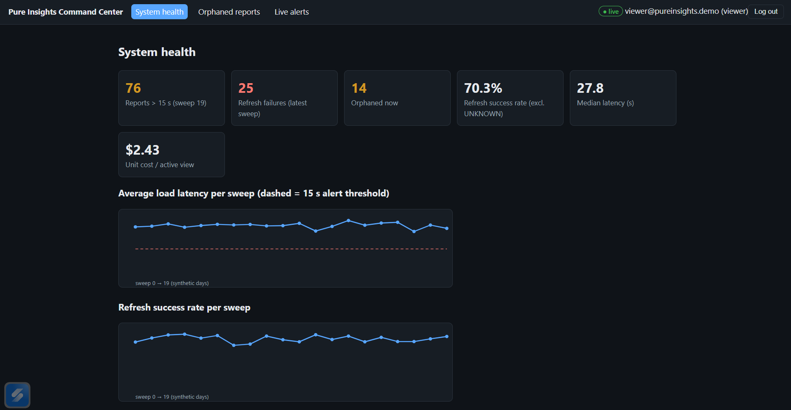
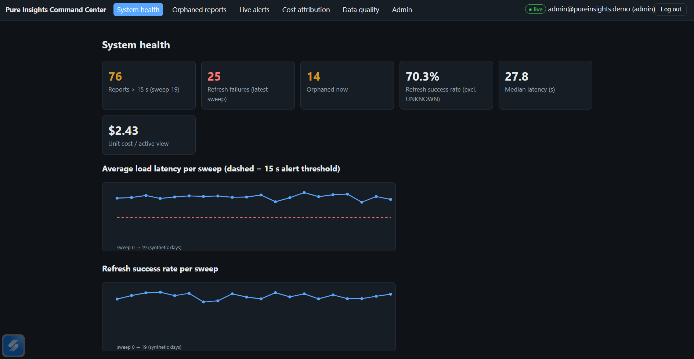
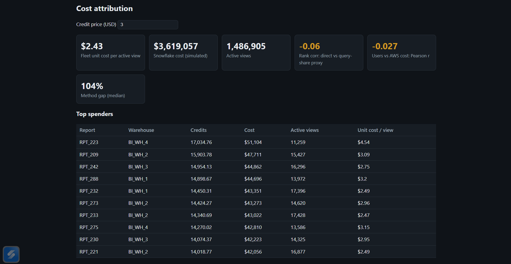
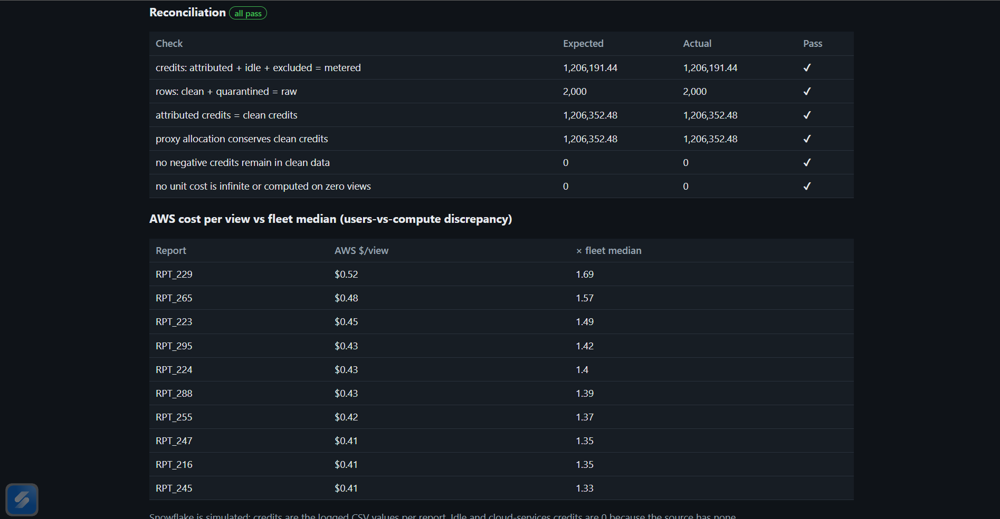
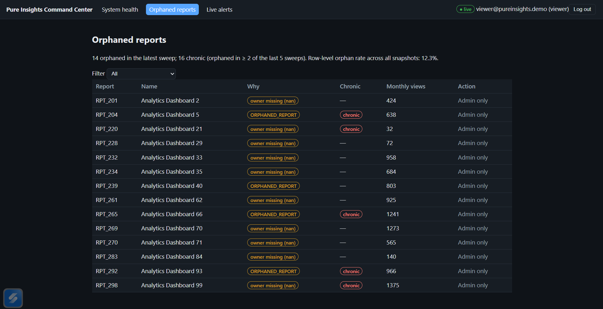
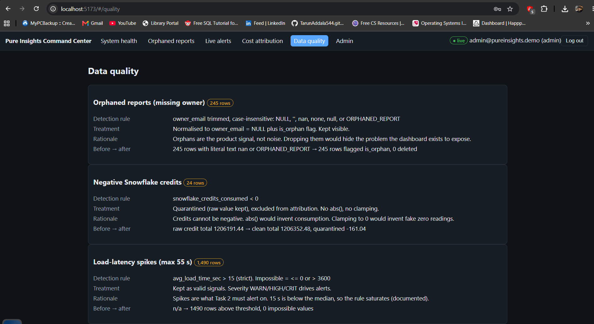
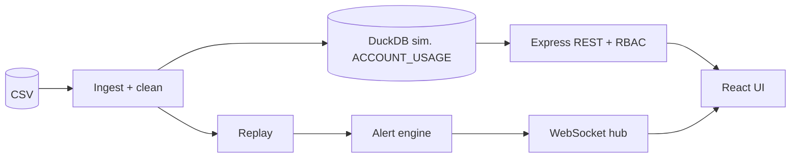

# Pure Insights Command Center

An operational admin dashboard for an analytics platform that lost its native admin tooling after a Tableau Server → custom portal migration. It restores visibility into **system health, orphaned reports, refresh failures, real-time alerts, and Snowflake credit cost attribution** (including unit cost per active user view).

**Stack:** React 18 + Vite · Node 22 + Express · WebSocket · JWT + RBAC · SQL (DuckDB at runtime, executed and validated on real Snowflake)

Built for *Case Study 3: Technical Data AI Validation – Monetization (Pure Insights Command Centre)*.

> **Honest scope.** The running app reads a **simulated** warehouse (DuckDB, schema `ACCOUNT_USAGE_SIM`); there is no live Snowflake connection at runtime. The SQL suite itself **has been executed on a real Snowflake account**: results and screenshots are in [`validation/`](validation/README.md). The dataset is **synthetic** (2,000 rows, no timestamps, so timestamps are synthetic and independent columns mean findings describe this file, not a real platform). This project was **AI-assisted**; see [How this was verified](#how-this-was-verified).

---

## Three decisions worth reading first

This project is about whether the numbers can be trusted, so these come before the feature list.

1. **Negative credits are quarantined, not `abs()`'d or clamped.** `abs()` invents consumption that never happened; clamping to zero invents 24 fake zero readings. The 24 rows (sum −161.04, 0.0134% of credits) are excluded from totals and listed for review, with raw values preserved.
2. **Unit cost is a ratio of sums, not a mean of row ratios.** The wrong method is computed anyway (`UNIT_COST_METHOD_SENSITIVITY`) to show the gap: median 104% difference, up to 2,181%.
3. **The mandated 15-second alert threshold fires on 74.5% of rows** (median load time 27.8 s, p90 49.1 s). The spec is implemented exactly as written, and the finding is reported with a recommendation to recalibrate. Noise is reduced downstream (severity tiers, incident grouping, toast cooldown), **never by suppressing events**.

---

## Results at a glance

| | |
|---|---|
| Rows | 2,000 = **1,976 clean + 24 quarantined** |
| Orphaned owners | 245 rows (128 `nan` + 117 `ORPHANED_REPORT`); **14 orphaned now**, 16 chronic |
| Latency > 15 s | 1,490 rows (WARN 580 · HIGH 552 · CRIT 358); 7 rows at exactly 15.0 correctly do not alert |
| Refresh | 564 failures (FAILED 382 + TIMED_OUT 182); 100 `UNKNOWN` kept as *unverified*, not failures |
| Users vs AWS cost | Pearson r = **−0.027**; 27 cost-per-view outliers; 93 rows where peak concurrency > monthly views |
| Fleet unit cost | **$2.434 per view** at $3.00/credit (a parameter) |
| Alert funnel | 2,054 firings → 1,203 stored incidents → 382 UI toasts |
| Tests | **39 / 39** passing; lint and format clean |
| Snowflake | SQL suite executed on a real account: **37 / 37 checks pass**, zero numeric differences vs pandas |

## Screenshots

| Role-based access (viewer gets 403 on `#/costs`) | Overview with 15 s threshold line |
|---|---|
|  |  |

| Live alerts over WebSocket | Cost attribution |
|---|---|
|  |  |

| Orphaned reports | Data quality |
|---|---|
|  |  |

---

## Deliverables

| # | Deliverable | Where |
|---|---|---|
| 1 | Runnable full-stack code | `backend/` (Node + Express), `frontend/` (React + Vite) |
| 2 | REST & WebSocket spec | [docs/API_SPEC.md](docs/API_SPEC.md), [docs/openapi.yaml](docs/openapi.yaml) (kept in sync with the routes by a test) |
| 3 | Snowflake cost allocation SQL suite | [sql/](sql/README.md) |
| – | Snowflake execution evidence | [validation/](validation/README.md): 3 worksheets, 37 checks, all PASS |
| – | Rubric traceability | [docs/RUBRIC_TRACEABILITY.md](docs/RUBRIC_TRACEABILITY.md) |

### The four injected defects

| Defect | Handling |
|---|---|
| Orphaned owner (`nan` / `ORPHANED_REPORT`) | Trimmed, case-insensitive detection of both forms; separate "orphaned now" and "chronic" views, because an any-ever rule would flag 94 of 100 reports |
| Negative credits | Quarantined (above), with a reconciliation check: 2,000 = 1,976 + 24 |
| Latency spikes up to 55 s | Strict `> 15` rule; WARN / HIGH / CRIT tiers; boundary-tested at 14.9 / 15.0 / 15.1 |
| Active users vs AWS cost mismatch | Three measures: headline correlation, row-level robust z-score (27 rows), hard-impossible-row rules (93 + 4) |

## Architecture



Layered routes → controllers → services → repositories. JWT auth; the permission matrix is enforced server-side in `backend/src/middleware/rbac.js` and mirrored in UI route guards. Details: [docs/ARCHITECTURE.md](docs/ARCHITECTURE.md).

## Real-time alerting

- WebSocket at `/ws`: **JWT verified at the HTTP upgrade**, role-aware channels, heartbeat, per-client subscribe filters, and a sequence number (`seq`) for gap detection.
- **Emits on every exceedance and failure** (the spec says "whenever"). Noise is handled downstream through edge-triggered incident grouping (open / escalated / repeat) and a per-report toast cooldown.
- A replay simulator streams the 20 sweeps (one sweep = one synthetic day, 3 s per tick). An admin **Inject** control fires a synthetic latency or refresh-failure event for live demos.
- An end-to-end test asserts alerts reach a connected client within one second.

## Cost attribution

- **Method A (used):** direct logged credits rolled up per report.
- **Method B (control):** query-share proxy. It conserves credits but has near-zero rank correlation with A (−0.06), so it is reported, not used.
- The reconciliation identity (sum of per-report credits = clean total) **fails loudly** if broken.
- Credit price is a parameter (default $3.00). Safe division via `NULLIF` throughout.

---

## Prerequisites

Node ≥ 22 (`.nvmrc`), npm ≥ 10. Python 3 + pandas only for the independent verifier (`npm run verify`). No credentials, Snowflake account or cloud services are needed.

## Run

```bash
git clone https://github.com/TarunAddala544/pure-insights-command-center.git
cd pure-insights-command-center
cp .env.example .env      # optional; defaults work
npm run setup             # npm install + seed/validate CSV and regenerate SQL/data docs
npm start                 # API + WebSocket on :4000, UI on http://localhost:5173
```

**No local Node?** Docker works as an optional route (no Dockerfile is provided; this uses the stock image):

```bash
docker run -it --rm -v "$PWD:/app" -w /app -p 5173:5173 -p 4000:4000 node:22-slim bash
# inside the container:
cp .env.example .env && npm run setup
npm run start -w backend > backend.log 2>&1 &
npm run dev -w frontend -- --host 0.0.0.0 --port 5173
```
Then open http://localhost:5173 on the host.

## Seeded users (password `Passw0rd!`, override with `DEMO_PASSWORD`)

| Role | Email | Can |
|---|---|---|
| Admin | `admin@pureinsights.demo` | everything: assign owners, inject alerts, replay control, users, audit |
| Analyst | `analyst@pureinsights.demo` | read all dashboards incl. cost and data quality, acknowledge/resolve alerts |
| Viewer | `viewer@pureinsights.demo` | health, orphans, alerts (read-only); cost, data quality and admin return 403 |

## Demo path

1. Log in as **viewer**: Cost / Data quality / Admin links are hidden; opening `#/costs` directly shows 403. (Hiding a nav link proves nothing; the server enforces it.)
2. Replay autostarts (one sweep of 100 reports every 3 s, `REPLAY_TICK_MS`). Open **Live alerts**: the badge shows connected; toasts appear for CRIT latency and refresh failures.
3. Log in as **admin** → **Admin** → *Inject latency* (e.g. 20 s) or *Inject refresh failure*: the alert arrives instantly in the feed. Pause / Start / Reset control the replay.
4. **Orphaned reports** → assign an owner (admin only). **Cost attribution** → change the credit price. **Data quality** → the four defects with counts.

## Tests, lint, verification

```bash
npm test             # 39 tests: cleaning parity, SQL parity + reconciliation, alert rules, RBAC matrix, API, WS e2e, spec sync
npm run lint         # ESLint
npm run format:check # Prettier
npm run verify       # pandas verifier + tests + lint
```

---

## How this was verified

| Check | Result |
|---|---|
| Automated tests (`npm test`) | 39 / 39 |
| Lint, format, frontend build | clean |
| Independent pandas verifier (`validation/verify.py`) | Node, SQL and API values match on all compared metrics |
| SQL reconciliation checks | 6 / 6 |
| **Real Snowflake execution** | **37 / 37 PASS**, zero numeric differences vs pandas (table below) |
| Human spot-check | 10 values recomputed by hand in Excel from the raw CSV (5 report unit costs, latest-sweep alert counts, negative-credit rows, exact-15.0 rows): **10 / 10 matched**. Inputs in [`validation/spot_check_sheet.csv`](validation/spot_check_sheet.csv) |
| Manual UI checks | Click-through as all three roles; admin Inject latency / refresh failure appeared live in the feed |

### Snowflake execution

The suite was run end to end in a Snowsight worksheet (`PURE_INSIGHTS.ACCOUNT_USAGE_SIM`, warehouse `PI_WH`). Screenshots and downloaded result CSVs:

| Worksheet | Screenshot | Results | Checks |
|---|---|---|---|
| `97_attribution_checks.sql` | [`validation/97_Screenshot.png`](validation/97_Screenshot.png) | [CSV](validation/97_snowflake_attribution_checks_results.csv) | 14 / 14 PASS |
| `98_spot_check.sql` | [`validation/98_Screenshot.png`](validation/98_Screenshot.png) | [CSV](validation/98_snowflake_spot_check_results.csv) | 10 / 10 PASS |
| `99_verification.sql` | [`validation/99_Screenshot.png`](validation/99_Screenshot.png) | [CSV](validation/99_snowflake_verifications_results.csv) | 13 / 13 PASS |

See [validation/README.md](validation/README.md) for what each worksheet asserts. Re-run only if you change `sql/01`–`07`.

### Simulated vs executed

- **Simulated:** the `ACCOUNT_USAGE_SIM` tables are look-alikes (Snowflake's real `ACCOUNT_USAGE` is read-only and the CSV has no query-level logs, so none are invented). The running app reads DuckDB.
- **Executed:** the SQL suite ran on a real Snowflake account and matched the pandas reference.

**AI-assisted development:** the code was written with Claude. I ran, tested, reviewed and hand-verified it as described above. The checks prove internal consistency and conformance to the stated rules, not business truth.

## Assumptions

- No timestamps in the CSV, so **sweep = row index ÷ 100**; one sweep = one synthetic day from 2026-09-01.
- No "active user" column exists, so `monthly_active_views` is the proxy.
- `TIMED_OUT` counts as a refresh failure; `UNKNOWN` is unverified, not a failure.
- The 4-warehouse mapping is simulated; credit price is a parameter.
- Dataset SHA-256: `bee8b5a451167aab11add9c6c2fc959f37d0c93b6ebc2560a93254849c8f4d50`

## Limitations

- JavaScript, not TypeScript; no frontend unit tests; no CI; no deployed URL or demo video.
- Alert history, users and audit log are in memory and reset on restart.
- Demo secrets, no HTTPS, no login rate limiting: an assessment build, not production-hardened.
- Not built: quarantine release/hold workflow, `explain` endpoint, fault-injection tests.

## Repository layout

```
backend/     Express API, RBAC, ingestion + cleaning, alert engine, WebSocket hub, replay simulator
frontend/    React + Vite: Overview, Orphans, Alerts, Costs, Data Quality, Admin
sql/         01_schema → 07_reporting_views (common dialect); snowflake/ setup, load, 97/98/99 checks
docs/        API_SPEC, ARCHITECTURE, DECISIONS, DATA_PROFILE, DATA_QUALITY_REPORT, RUBRIC_TRACEABILITY, HANDOFF, openapi.yaml
validation/  pandas verifier, golden numbers, Snowflake run evidence, spot-check sheet
scripts/     seed, doc generation, Snowflake script generation
data/        Case_Study_3_Pure_Insights_Monitoring.csv (synthetic, supplied for the assessment)
```

Start with [`docs/DECISIONS.md`](docs/DECISIONS.md) for the rationale behind each choice.
