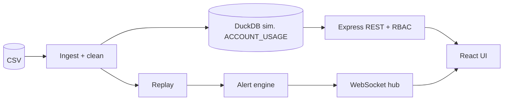

# Pure Insights Command Center

Platform operational analytics after a Tableau → custom portal migration: system health, orphaned reports, real-time WebSocket alerting, and Snowflake credit cost attribution with unit cost per active user view.

> **Honest scope:** the running application reads a **simulated** warehouse (DuckDB, schema `ACCOUNT_USAGE_SIM`) — there is no live Snowflake connection at runtime. The SQL suite itself **has been executed on a real Snowflake account**; results and screenshots are in [`validation/`](validation/README.md). The dataset is **synthetic** (`data/Case_Study_3_Pure_Insights_Monitoring.csv`, 2,000 rows, no timestamps, so timestamps are synthetic). See [docs/DECISIONS.md](docs/DECISIONS.md).

## Deliverables

| # | Deliverable | Where |
|---|---|---|
| 1 | Runnable full-stack code | `backend/` (Node + Express), `frontend/` (React + Vite) |
| 2 | REST & WebSocket spec | [docs/API_SPEC.md](docs/API_SPEC.md), [docs/openapi.yaml](docs/openapi.yaml) |
| 3 | Snowflake cost allocation SQL suite | [sql/](sql/README.md) |
| – | Snowflake execution evidence | [validation/](validation/README.md) — 3 worksheets, 37 checks, all PASS |
| – | Traceability checklist | [docs/RUBRIC_TRACEABILITY.md](docs/RUBRIC_TRACEABILITY.md) |

## Architecture



Details: [docs/ARCHITECTURE.md](docs/ARCHITECTURE.md).

## Prerequisites

Node ≥ 22 (`.nvmrc`), npm ≥ 10. Python 3 + pandas only for the independent verifier (`npm run verify`).

## Run (one command after install)

```bash
cp .env.example .env      # optional; defaults work
npm run setup             # npm install + seed/validate CSV and regenerate SQL/data docs
npm start                 # API + WebSocket on :4000, UI on http://localhost:5173
```

## Seeded users (password `Passw0rd!`, override with `DEMO_PASSWORD`)

| Role | Email | Can |
|---|---|---|
| Admin | `admin@pureinsights.demo` | everything: assign owners, inject alerts, replay control, users, audit |
| Analyst | `analyst@pureinsights.demo` | read all dashboards incl. cost and data quality, acknowledge/resolve alerts |
| Viewer | `viewer@pureinsights.demo` | health, orphans, alerts (read-only); cost/DQ/admin return 403 |

## Demo path

1. Log in as **viewer**: Cost/Data quality/Admin links are hidden; opening `#/costs` shows 403.
2. Replay autostarts (one sweep of 100 reports every 3 s, `REPLAY_TICK_MS`). Open **Live alerts**: status badge shows connected; toasts appear for CRIT latency and refresh failures.
3. Log in as **admin** → **Admin** → *Inject latency* (e.g. 20 s) or *Inject refresh failure*: the alert arrives instantly in the feed. Use Pause/Start/Reset to control replay.
4. **Orphaned reports** → assign an owner (admin only). **Cost attribution** → change the credit price. **Data quality** → the four defects with counts.

## Tests, lint, verification

```bash
npm test             # 39 tests: cleaning parity, SQL parity + reconciliation, alert rules, RBAC matrix, API, WS e2e, spec sync
npm run lint         # ESLint
npm run format:check # Prettier
npm run verify       # pandas verifier + tests + lint
```

## Demonstration evidence

### Snowflake execution — captured

The SQL suite was run end to end in a Snowsight worksheet (`PURE_INSIGHTS.ACCOUNT_USAGE_SIM`, warehouse `PI_WH`). Screenshots and downloaded result CSVs:

| Worksheet | Screenshot | Results | Checks |
|---|---|---|---|
| `97_attribution_checks.sql` | [`validation/97_Screenshot.png`](validation/97_Screenshot.png) | [CSV](validation/97_snowflake_attribution_checks_results.csv) | 14 / 14 PASS |
| `98_spot_check.sql` | [`validation/98_Screenshot.png`](validation/98_Screenshot.png) | [CSV](validation/98_snowflake_spot_check_results.csv) | 10 / 10 PASS |
| `99_verification.sql` | [`validation/99_Screenshot.png`](validation/99_Screenshot.png) | [CSV](validation/99_snowflake_verifications_results.csv) | 13 / 13 PASS |

See [validation/README.md](validation/README.md) for what each worksheet asserts.

### Application UI — not yet captured

Capture these after starting the app locally, then replace this notice with links. **The files below do not exist yet**; the list is a checklist, not a claim.

| Evidence | Filename | What to demonstrate |
|---|---|---|
| Health dashboard | `docs/screenshots/overview.png` | KPIs and system health |
| Live alerts | `docs/screenshots/alerts.png` | Latency >15 s and failed refresh events |
| Orphan management | `docs/screenshots/orphans.png` | Missing owners and admin assignment |
| Cost attribution | `docs/screenshots/costs.png` | Credits and unit cost per view |
| Data quality | `docs/screenshots/data-quality.png` | Quarantine and anomaly counts |
| RBAC | `docs/screenshots/viewer-access.png` | Viewer denied restricted pages |

A short demo recording may follow the same sequence as the [demo path](#demo-path).

## Final submission verification

On a clean machine, run:

```bash
npm ci
npm run seed
npm test
npm run lint
npm run format:check
npm run build -w frontend
npm start
```

Then manually verify login for all three roles, an injected latency event, a refresh-failure event, orphan assignment, and cost attribution. Record actual results in [docs/HANDOFF.md](docs/HANDOFF.md); do not treat prior development claims as a substitute for a clean run. The repository does not currently include a deployment URL or recorded demo video.

The Snowflake half of the suite does not need re-running to be believed — it has already been executed and the outputs are committed under [`validation/`](validation/README.md). Re-run it only if you change `sql/01`–`07`.


## Limitations and verification scope

**Verified:** the SQL suite runs on both engines — locally against DuckDB (`npm test`) and on a real Snowflake account (evidence in [`validation/`](validation/README.md)). All 37 Snowflake checks agree with the pandas reference values.

**Still simulated by design:** the `ACCOUNT_USAGE_SIM` tables are look-alikes, not `SNOWFLAKE.ACCOUNT_USAGE`, because the source CSV has no query-level logs; and the application reads DuckDB at runtime rather than connecting to Snowflake.

**Not provided:** Docker, CI, frontend unit tests, a deployed URL, and application screenshots. The code uses JavaScript rather than TypeScript. See [docs/DECISIONS.md](docs/DECISIONS.md) for scope and [docs/HANDOFF.md](docs/HANDOFF.md) for the current verification checklist.
