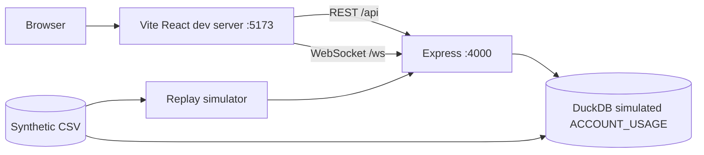

# Architecture

```mermaid
flowchart LR
  CSV[(data/*.csv\n2,000 rows)] --> ING[Node ingestion + cleaning\ndomain/clean.js]
  ING --> WH[(DuckDB\nACCOUNT_USAGE_SIM)]
  SQL[sql/01..07\ncost suite] --> WH
  ING --> REP[Replay simulator\n1 sweep / tick]
  REP --> ENG[Alert engine\nrules + incidents + toast cooldown]
  ENG --> AS[Alert service]
  AS --> AR[(ALERTS table)]
  AS --> HUB[WebSocket hub\nJWT, channels, heartbeat]
  WH --> AN[Analytics service]
  UI[React + Vite] -- REST /api + JWT --> API[Express\nroutes→controllers→services→repositories]
  API --> AN
  API --> AS
  HUB -- ws /ws --> UI
  PY[validation/verify.py\npandas] -. golden.json .-> TESTS{{node --test}}
  ING -.-> TESTS
  WH -.-> TESTS
```

## Backend layers (`backend/src`)

| Layer | Folder | Rule |
|---|---|---|
| Routes | `routes/` | One route table: method, path, permission, handler, zod schema. Also the source for the OpenAPI sync test. |
| Controllers | `controllers/` | HTTP ↔ service translation only. |
| Services | `services/`, `sim/` | Business logic: auth, analytics, alerts, replay. |
| Repositories | `repositories/` | All SQL/DB access (DuckDB wrapper, alert, user, audit stores, warehouse build). |
| Domain | `domain/` | Pure functions: cleaning, alert engine, cost math. No I/O except reading the CSV. |
| Cross-cutting | `middleware/`, `config/`, `utils/` | RBAC, validation, error envelope, env config, JSON logger. |

`context.js` is the composition root; tests build the same context with replay in manual mode.

## Data flow and where validation sits

1. **Ingest:** CSV read as text, typed, unparsable numbers rejected loudly, orphan/negative flags attached (`domain/clean.js`).
2. **Warehouse:** raw rows inserted untouched into `RAW_REPORT_SNAPSHOTS`; SQL 02 quarantines/cleans; 03 flags anomalies; 04–05 attribute and compute unit cost; 06 reconciles (fails loudly); 07 exposes views.
3. **Three-way parity:** Node ↔ SQL ↔ pandas must agree (`domain.test.js`, `sql.test.js`).
4. **Replay → alerts → WebSocket:** each sweep passes through the alert engine; every firing is broadcast, incident-level events are persisted.

## Frontend

React 18 + Vite, hash routing with a route table carrying the permission per page (nav hides links, guard shows 403 on direct access). `AlertsProvider` owns the WebSocket (auto-reconnect with backoff + jitter), the live feed, toasts and replay status. Every data page uses `useAsync` + `<Async>` for loading/error/empty states.

## Security notes

bcrypt password hashes, JWT HS256, RBAC middleware on every protected route, zod validation, generic 500s, uniform login failure, request IDs, JSON body limit 100 kB. CORS is open (`*`) because the demo uses the Vite proxy; restrict it in a real deployment.

## Runtime and deployment boundary

The supplied project is a **local demonstration architecture**, not a documented cloud deployment. The Vite development server serves the React frontend and proxies API/WebSocket traffic to Express on port 4000. Express serves REST endpoints and the WebSocket hub; DuckDB provides a simulated Snowflake-style usage warehouse. The replay simulator drives alerts from the synthetic CSV.



A production deployment would need separate static hosting, an HTTPS reverse proxy with WebSocket upgrade support, restricted CORS, secret management, persistent storage, and monitoring. These are future deployment considerations, not implemented features.

## Configuration reference

The sample `.env.example` documents the backend configuration, including `WS_HEARTBEAT_MS` (default 15000 milliseconds), `REPLAY_TICK_MS`, latency thresholds, and the credit price.
